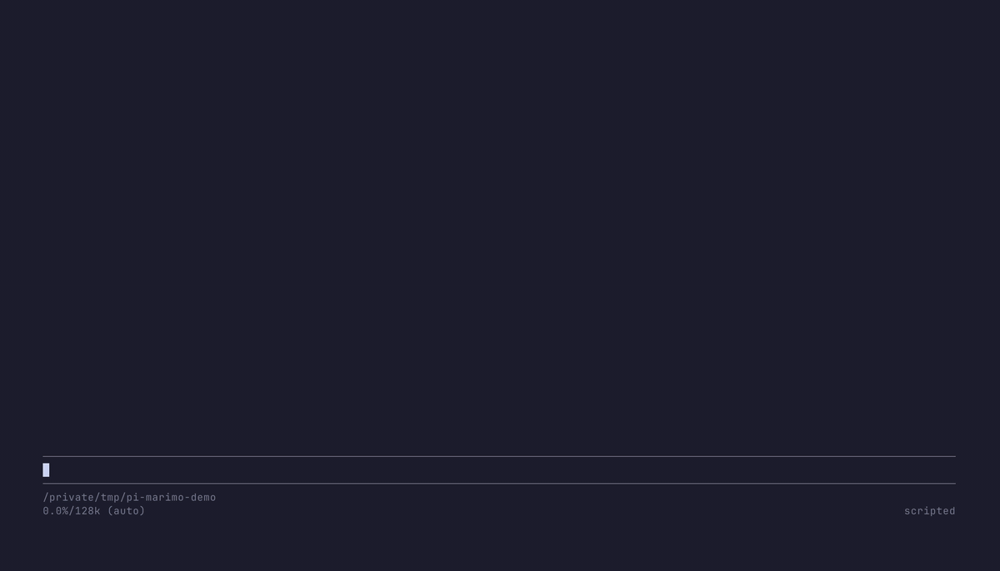

# pi-marimo

[](https://www.npmjs.com/package/pi-marimo) [](https://github.com/justmytwospence/pi-marimo/actions/workflows/check.yml) [](https://justmytwospence.github.io/pi-marimo/)

**The [marimo](https://marimo.io) notebook your agent is editing, live in your terminal beside the chat.**



pi-marimo is an extension for the [Pi](https://pi.dev) coding agent. Your agent edits the notebook through [marimo pair](https://docs.marimo.io/guides/generate_with_ai/marimo_pair/); you watch it run, read it and steer it from the terminal, docked beside the conversation. You need the browser much less.

- **The notebook beside the chat.** `ctrl+'` docks an outline of sections and cells, and the selected cell's output, error and code.
- **Real outputs in the terminal.** Tables you can page, sort, search and filter; Matplotlib, Vega-Lite and live Plotly charts on Kitty-graphics terminals; widgets you drive with keys or the mouse.
- **What runs, as it runs.** A spinner and elapsed time, the dataflow around the selected cell, the run chain, and errors with their tracebacks.
- **The agent knows the notebook.** Each prompt carries the notebook's current state: cells, what they define, what is stale or broken.
- **What the agent changed, and undo.** Changed cells are marked, with a diff, the cells it reruns, and `u` to revert.
- **A native pair agent.** On marimo's host protocol, Pi attaches as an agent and receives the notebook's messages.

## Install

You need Pi in a terminal (docking beside the chat needs `"tuiMode": "fullscreen"` in Pi's settings), Node 22.19 or later and marimo.

```sh
pi install npm:pi-marimo
npx skills add marimo-team/marimo-pair -s marimo-pair -a pi   # lets the agent edit cells
```

## Quick start

1. Open a notebook from Pi: `/marimo new analysis.py`, or `/marimo edit analysis.py` for an existing one, such as [`examples/demo.py`](examples/demo.py). Pi starts the marimo server if none is running; no browser is needed.
2. Ask the agent to work in it: "load sales.csv and chart revenue by month".
3. Press `ctrl+'`. The notebook docks beside the chat and follows the running cell.
4. `ctrl+]` switches between the chat and the notebook, and `?` lists every key.

A notebook you already have open in the browser (started with `marimo edit --no-token`) is followed automatically when it is under Pi's working directory.

## Compatibility

marimo 0.25.2 and marimo main (the host protocol); charts need a terminal with Kitty graphics (Ghostty, Kitty, herdr). [Details and known gaps](https://justmytwospence.github.io/pi-marimo/compatibility/).

## Documentation

- [Getting started](https://justmytwospence.github.io/pi-marimo/getting-started/)
- Guide: [the notebook view](https://justmytwospence.github.io/pi-marimo/guide/notebook-view/), [tables, widgets and charts](https://justmytwospence.github.io/pi-marimo/guide/data/), [editing cells](https://justmytwospence.github.io/pi-marimo/guide/editing/), [working with the agent](https://justmytwospence.github.io/pi-marimo/guide/agent/), [background execution](https://justmytwospence.github.io/pi-marimo/guide/execution/)
- Reference: [keys](https://justmytwospence.github.io/pi-marimo/reference/keys/), [commands and tools](https://justmytwospence.github.io/pi-marimo/reference/commands/), [configuration](https://justmytwospence.github.io/pi-marimo/reference/configuration/)
- [How it works](https://justmytwospence.github.io/pi-marimo/how-it-works/), [troubleshooting](https://justmytwospence.github.io/pi-marimo/troubleshooting/), [development](https://justmytwospence.github.io/pi-marimo/development/)

## Development

```sh
npm ci && npm run check
```

Live tests, the demo notebook and the docs build are in [Development](https://justmytwospence.github.io/pi-marimo/development/); releases and rollout are in `AGENTS.md`.

## License

MIT. See [LICENSE](./LICENSE).
