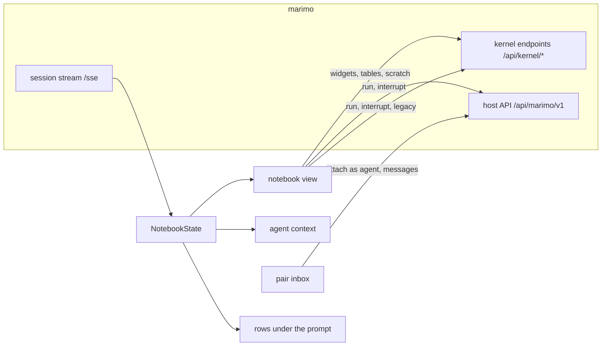

# How it works

pi-marimo subscribes to each notebook session's message stream (`/sse`) as a read-only kiosk viewer, so it never takes the notebook over from your browser. marimo replays the session on connect; after that pi-marimo receives every cell's code, status, output and errors, the dataflow graph and the variable values. Actions from the view are separate requests to marimo's kernel endpoints, sent through Pi's own session when the browser's is gone. Servers are found through marimo's registry (`$XDG_STATE_HOME/marimo/servers`) and each server's `/api/sessions`.

Limits:

- Widget values changed in a browser show in the view after a reconnect.
- "Changed by the agent" means any code-mode change; marimo cannot tell agents apart.
- The rows and the view exist only in Pi's terminal UI.

## Integrations

Each is optional and talks over Pi's event bus. Native execution supervision, completion subscriptions, notebook rows and agent continuation work without any of these packages.

- [pi-bg](https://pi-plugins.vercel.app/plugins/pi-bg/): notebooks are listed in `/tasks`, and `bg_wait` can wait on `marimo:<path>` until the notebook's cells finish. A marimo server pi-bg runs is shown with its notebook's state, and stopping a marimo-pair job interrupts the cells it started. Independent services such as sleep prevention remain separate tasks; their count is not duplicated notebook work.
- [pi-subagents](https://pi-plugins.vercel.app/plugins/pi-subagents/): the notebook rows join its panel under the prompt.
- [pi-sidebar](https://pi-plugins.vercel.app/plugins/pi-sidebar/): shares the right-hand side.
- [pi-status-footer](https://pi-plugins.vercel.app/plugins/pi-status-footer/): notebook rows in the footer.
- [pi-herdr](https://pi-plugins.vercel.app/plugins/pi-herdr/): in a [Herdr](https://herdr.dev) pane, a notebook still running after the turn ends shows in the `$marimo` pane token, with a notification when it finishes.
- [pi-next-prompt](https://pi-plugins.vercel.app/plugins/pi-next-prompt/): a new Lens selection offers "Use Lens to address S1" as the next prompt.
- [pi-vim](https://pi-plugins.vercel.app/plugins/pi-vim/): vim keys in the view's prompts.
