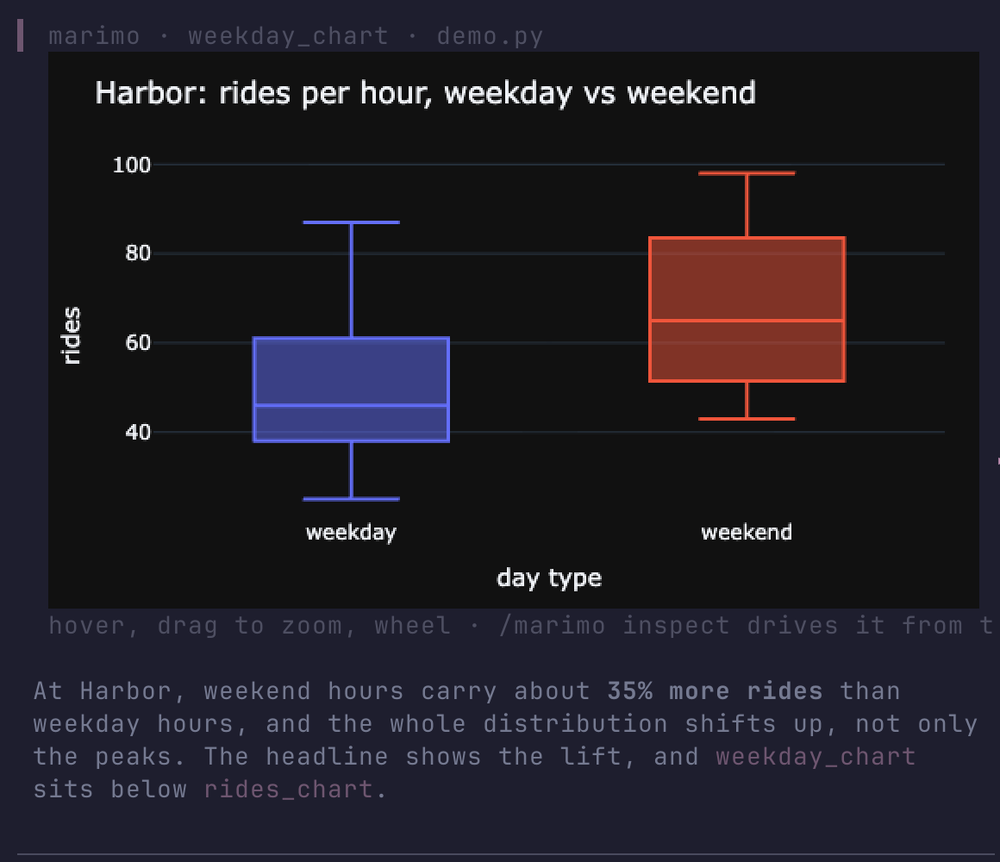
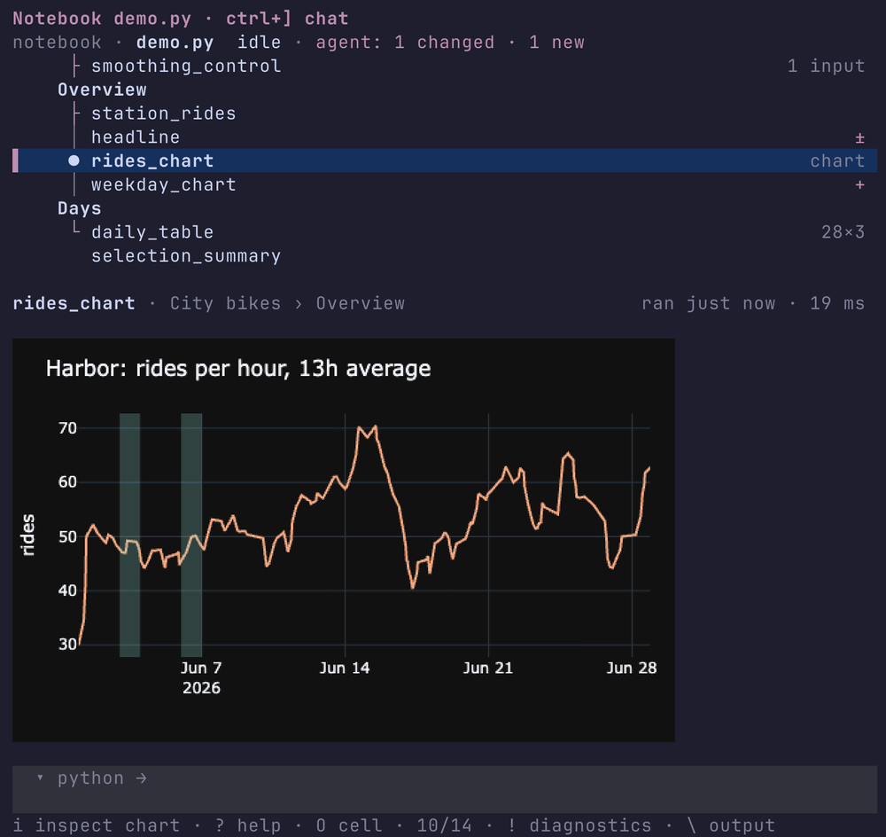
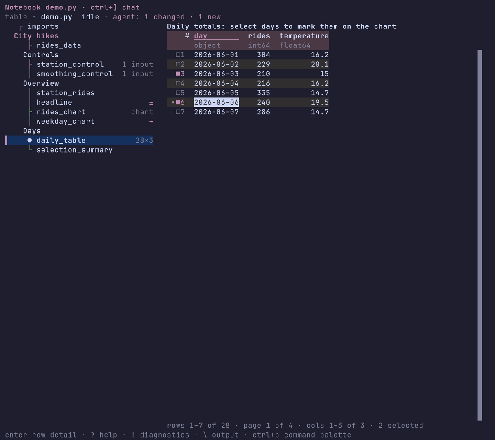
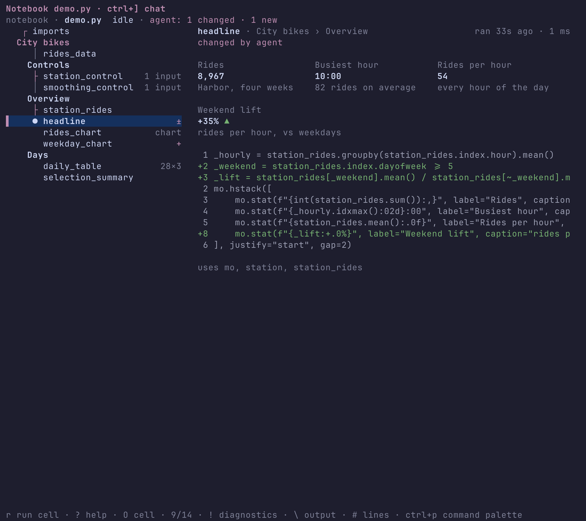

# pi-marimo

**The [marimo](https://marimo.io) notebook your agent is editing, live in your terminal beside the chat.**

<figure class="demo-player" data-chapters="assets/demo.json">
  <video src="assets/demo.mp4" autoplay loop muted playsinline preload="auto" aria-label="pi-marimo demo"></video>
  <div class="demo-scrub" role="slider" tabindex="0" aria-label="Demo timeline" aria-valuemin="0" aria-valuenow="0"><div class="demo-scrub-fill"></div></div>
  <figcaption><span class="demo-chapter">pi-marimo</span> · drag the bar to scrub, click the video to pause</figcaption>
</figure>

One minute, unedited: the agent changes a notebook while it runs beside the chat, looks at the chart it made, and you take over with the keyboard. The model's replies are scripted so every take is the same; the notebook, its kernel, marimo and pi-marimo are real ([how it is recorded](development.md#recording-the-demo)).

pi-marimo is an extension for the [Pi](https://pi.dev) coding agent. Your agent edits a marimo notebook through [marimo pair](https://docs.marimo.io/guides/generate_with_ai/marimo_pair/); you watch it run, read it, and steer it from the terminal, without leaving the conversation.

```sh
pi install npm:pi-marimo
npx skills add marimo-team/marimo-pair -s marimo-pair -a pi   # lets the agent edit cells
```

Then `/marimo edit notebook.py` in Pi. [Getting started](getting-started.md) has the requirements and a tour.

## What you get

<div class="grid cards" markdown>

-   

    **The agent works in the notebook you see.** Each prompt carries the notebook's state: cells, what they define, what is stale or broken. `marimo_chart` puts a cell's chart in the chat and gives the agent its picture. [Working with the agent](guide/agent.md)

-   

    **Real outputs, and they react.** Matplotlib, Vega-Lite and live Plotly charts on Kitty-graphics terminals, stat cards, Markdown, and widgets you drive with keys or the mouse. [Tables, widgets and charts](guide/data.md)

-   

    **Tables you can work in.** Page, sort, search, filter and select rows; the selection goes back to the kernel like a click in the browser. [Tables](guide/data.md)

-   

    **What the agent changed, and undo.** Changed cells are marked, with a diff and the cells that rerun. `u` reverts a change or deletes a cell the agent created. [Reverting](guide/agent.md#reverting-the-agents-changes)

</div>

Also: a spinner and elapsed time on the running cell, the dataflow around the selected cell, the run chain, errors with their tracebacks, variables and packages. [The notebook view](guide/notebook-view.md) covers all of it, and [Keys](reference/keys.md) lists every key.

## Built on marimo

A marimo notebook is a dataflow graph with a live kernel, not a list of cells to run in order. That is what the view shows: which cells depend on which, which are stale or blocked, and what a run will touch next. pi-marimo adds no kernel and no file format of its own; it is a second client of the server you already run.

| pi-marimo | marimo |
|---|---|
| follows cells, outputs, errors and variables | the session stream (`/sse`), as a read-only viewer, so it never takes the notebook from your browser |
| the agent's edits | [marimo pair](https://docs.marimo.io/guides/generate_with_ai/marimo_pair/) and code mode in the running kernel, so edits pass the same checks as edits in the browser |
| run, interrupt, widgets, table paging and search | the kernel endpoints; on marimo main, the host protocol |
| finds running notebooks | marimo's server registry; on marimo main, host records |
| Pi as a pair agent | on marimo main, Pi attaches as an agent named **Pi** and receives the notebook's messages |

[How it works](how-it-works.md) has the diagram, and [Compatibility](compatibility.md) lists what differs between released marimo and main.

**If you work on marimo:** pi-marimo is a third-party client and leans on a few internal surfaces. [What would help from marimo](compatibility.md#what-would-help-from-marimo) is the short list that would let it use only supported ones.

## Next

- [Getting started](getting-started.md): install and a 60-second tour with the notebook from the video.
- [The notebook view](guide/notebook-view.md) and [all keys](reference/keys.md).
- [Compatibility](compatibility.md): marimo versions, what main changes, and what would help.
- [How it works](how-it-works.md).
